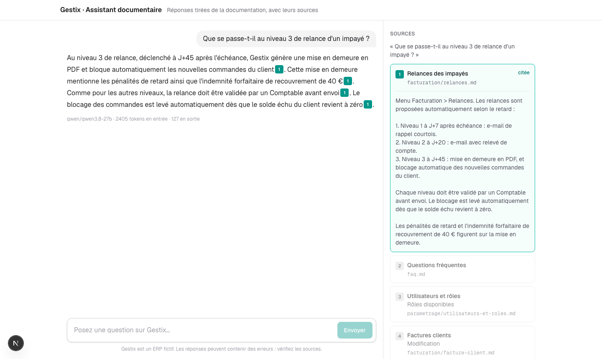
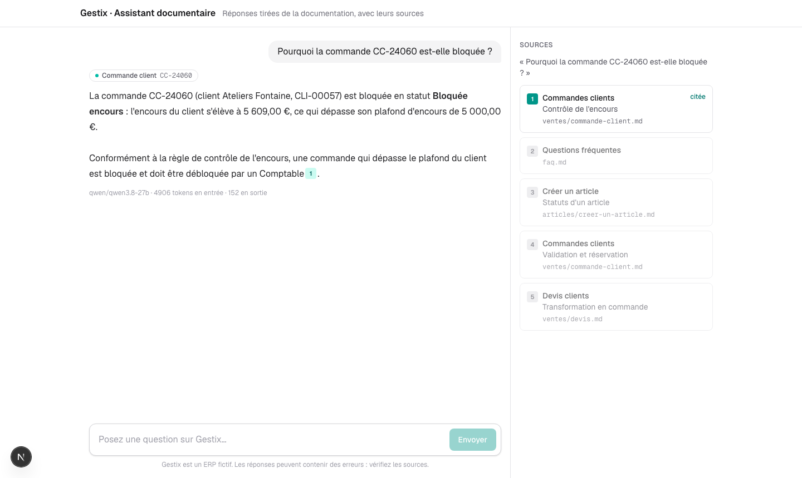
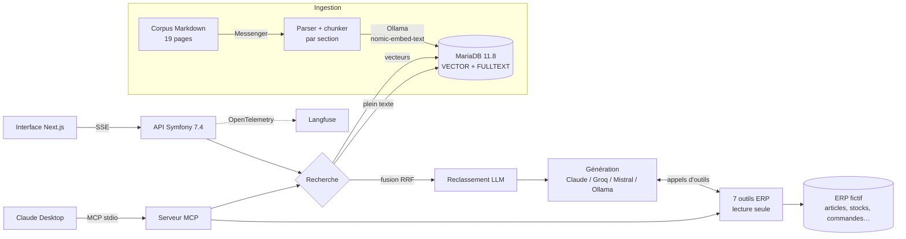

# Gestix · Assistant documentaire IA

Assistant IA pour **Gestix**, un ERP fictif de gestion commerciale et logistique. Il répond aux questions des
utilisateurs à partir de la documentation en **citant ses sources**, **refuse** quand l'information n'y figure pas,
**interroge les données de l'ERP** grâce à des outils (agent), et expose ces outils à **Claude Desktop via MCP**.
Sa qualité est **mesurée** par une suite d'évaluation de 69 questions, rejouée à chaque évolution.

> Projet portfolio. La société (Distrilog SAS), la documentation et les données sont entièrement fictives.



## Ce que fait l'assistant

| | |
|---|---|
| **RAG avec citations** | Chaque phrase de la réponse renvoie à l'extrait de documentation qui la justifie ; un clic affiche le passage. |
| **Refus explicite** | Hors du périmètre de la documentation, il répond « Je ne trouve pas cette information » au lieu d'inventer (100 % de refus justes mesurés). |
| **Recherche hybride + reclassement** | Vecteurs (MariaDB vector) et plein texte, fusionnés par RRF, puis reclassés par un LLM : la bonne section est dans les 5 extraits pour 100 % des questions. |
| **Agent** | 7 outils en lecture seule sur l'ERP (stock, commandes, clients, factures, réapprovisionnement), combinés avec la documentation. |
| **Serveur MCP** | Les mêmes outils, plus la recherche documentaire, utilisables depuis Claude Desktop ou Claude Code. |
| **Streaming** | Réponse affichée au fil de l'eau (SSE), sources et citations comprises. |
| **Observabilité** | Chaque question est tracée dans Langfuse (OpenTelemetry) : recherche, appels au LLM, tokens, temps jusqu'au premier mot, outils. |
| **Multi-fournisseurs** | Claude (citations natives), Groq (gratuit), Mistral ou un modèle local via Ollama, au choix par une variable d'environnement. |



## Architecture



**Parcours d'une question** : la question est vectorisée, les 20 meilleurs extraits par vecteurs et par plein texte
sont fusionnés (RRF), un LLM reclasse les 10 premiers, et les 5 retenus sont envoyés au modèle de génération avec la
liste des outils. Le modèle peut consulter l'ERP (jusqu'à 5 tours), puis rédige la réponse citée, transmise en streaming.

## Résultats mesurés

Les mesures sont produites par [promptfoo](https://www.promptfoo.dev/) sur un jeu de questions versionné
([`evals/dataset.yaml`](evals/dataset.yaml)) avec des **contrôles sans LLM**, reproductibles : section retrouvée,
faits attendus présents dans la réponse, citations vers une source acceptée, refus, outil appelé.

### Référence : recherche vectorielle seule ([détail](evals/results/baseline.md))

54 questions : 32 faits précis, 8 réponses sur plusieurs pages, 6 reformulations, 8 hors corpus.

| Mesure | Résultat |
|---|---|
| Réussite complète (tous les contrôles) | **94 %** (51/54) |
| Faits attendus présents dans la réponse | 93 % (43/46) |
| Citations correctes | 93 % (43/46) |
| Refus justes sur les questions hors corpus | **100 %** (8/8) |
| Latence médiane | 269 ms |

Les 3 échecs venaient de la recherche : faute d'extrait pertinent, le modèle refusait au lieu d'inventer.

### Recherche hybride et reclassement ([détail](evals/results/j7-recherche.md))

| Mode de recherche | Bonne section parmi les 5 extraits | MRR | Latence |
|---|---|---|---|
| Vecteurs seuls | 93 % | 0,82 | 19 ms |
| Vecteurs + plein texte (RRF) | 91 % | 0,84 | 24 ms |
| **+ reclassement par LLM** | **100 %** | **0,99** | 381 ms |

### Agent sur les données de l'ERP ([détail](evals/results/j8-agent.md))

15 questions dont les réponses attendues viennent des données de démonstration.

| Mesure | Première mesure | Après corrections |
|---|---|---|
| Bon outil appelé | 87 % | **100 %** (14/14) |
| Valeurs exactes dans la réponse | 53 % | **100 %** (14/14) |

## Ce que les mesures ont appris

- **La recherche plein texte seule n'apportait rien** sur ce corpus (pas de racinisation, mots vides anglais
  dans InnoDB). Avec 10 extraits, les deux méthodes trouvaient pourtant 100 % des sections : le problème était
  le **classement**, que le reclassement par LLM règle (MRR 0,82 → 0,99).
- **Un agent vaut autant par ses outils que par son modèle.** Les échecs de la première mesure venaient de
  descriptions ambiguës, d'un filtre trop strict (« gants » cherchés dans la mauvaise famille), d'un paramètre
  facultatif envoyé à `null` et refusé par la validation de schéma, d'unités prêtant à confusion. Corrigés dans
  les outils, ils sont passés de 53 % à 100 %.
- **L'évaluation a trouvé des bugs que les tests manuels ne voyaient pas**, dont deux dans
  [`inm39/mariadb-vector-bundle`](https://github.com/IMAMx39/mariadb-vector-bundle) (mon bundle Symfony pour
  MariaDB vector) : écriture binaire rejetée par PDO, et lecture qui prenait pour du JSON tout vecteur dont le
  premier octet vaut `[` (1 chunk sur 55, erreur 500 sur les questions qui le retrouvaient).

## Stack

| Couche | Technologies |
|---|---|
| Backend | PHP 8.2, Symfony 7.4, Doctrine ORM, Messenger, symfony/mcp-bundle |
| Données | MariaDB 11.8 (type `VECTOR`, index HNSW, `FULLTEXT`), [`inm39/mariadb-vector-bundle`](https://github.com/IMAMx39/mariadb-vector-bundle) |
| IA | Ollama (`nomic-embed-text`, 768 dimensions), SDK PHP Anthropic, API Chat Completions (Groq, Mistral, Ollama) |
| Frontend | Next.js 16, React 19, TypeScript, Tailwind CSS 4 |
| Qualité | promptfoo (évaluation), Langfuse (traces OpenTelemetry) |
| Infra | Docker Compose (php-fpm, worker, nginx, mariadb, frontend) |

## Lancer le projet

**Prérequis** : Docker (OrbStack ou Docker Desktop), [Ollama](https://ollama.com) installé sur la machine, et une
clé d'API gratuite [Groq](https://console.groq.com) (ou une clé Anthropic).

```bash
git clone https://github.com/IMAMx39/erp-assistant.git && cd erp-assistant
ollama pull nomic-embed-text

cp .env.example .env        # puis renseigner LLM_PROVIDER=groq et GROQ_API_KEY
make up                     # construit et démarre la pile

docker compose exec php composer install
docker compose exec php php bin/console doctrine:migrations:migrate -n
docker compose exec php php bin/console app:corpus:ingest   # indexation (traitée par le worker)
make fixtures                                               # données de l'ERP fictif
```

Interface : <http://localhost:3000> · API : <http://localhost:8080/api/search?q=inventaire>

**Évaluation** (la pile doit tourner) :

```bash
make eval-retrieval MODE=hybrid                    # recherche seule, sans LLM, quelques secondes
make eval MODE=hybrid_rerank EVAL_DELAY=18000      # jeu complet (~16 min avec l'offre gratuite de Groq)
```

**Claude Desktop** : copier [`docs/claude_desktop_config.example.json`](docs/claude_desktop_config.example.json)
dans *Réglages › Développeur › Modifier la configuration*, en remplaçant `/CHEMIN/VERS/docker` par le résultat de
`which docker` et `/CHEMIN/VERS/erp-assistant` par le dossier du projet (Claude Desktop exige des chemins absolus),
puis redémarrer Claude Desktop.

**Langfuse** (facultatif) : renseigner `LANGFUSE_PUBLIC_KEY` et `LANGFUSE_SECRET_KEY` dans `.env`.

## Organisation du code

```
backend/src/
├── Ingestion/      parser Markdown, découpage par section, indexation asynchrone (Messenger, idempotente)
├── Embedding/      embeddings Ollama
├── Retrieval/      recherche vectorielle, plein texte, fusion RRF, reclassement LLM
├── Chat/           RAG, prompts, générateurs (Claude, Chat Completions), streaming SSE
├── Agent/          registre et 7 outils de consultation de l'ERP
├── Erp/            ERP fictif : entités, statuts, calculs (stock disponible, encours, réapprovisionnement)
├── Mcp/            serveur MCP
└── Observability/  traces Langfuse (OpenTelemetry)
corpus/             documentation Gestix (Markdown)
evals/              jeu de questions, contrôles, synthèses, rapports de mesure
frontend/           interface de chat Next.js
```

## Limites connues

- L'offre gratuite de Groq (200 000 tokens par jour et par modèle) limite le nombre de mesures complètes par jour.
- Le chemin Claude (citations natives, outils natifs) est vérifié hors ligne, avec des réponses simulées, mais pas
  encore sur l'API réelle.
- La mesure complète combinant recherche hybride avec reclassement et agent reste à rejouer d'une traite ; les
  résultats ci-dessus proviennent de mesures séparées.
- Pas encore de tests unitaires : la qualité est aujourd'hui garantie par l'évaluation de bout en bout.
